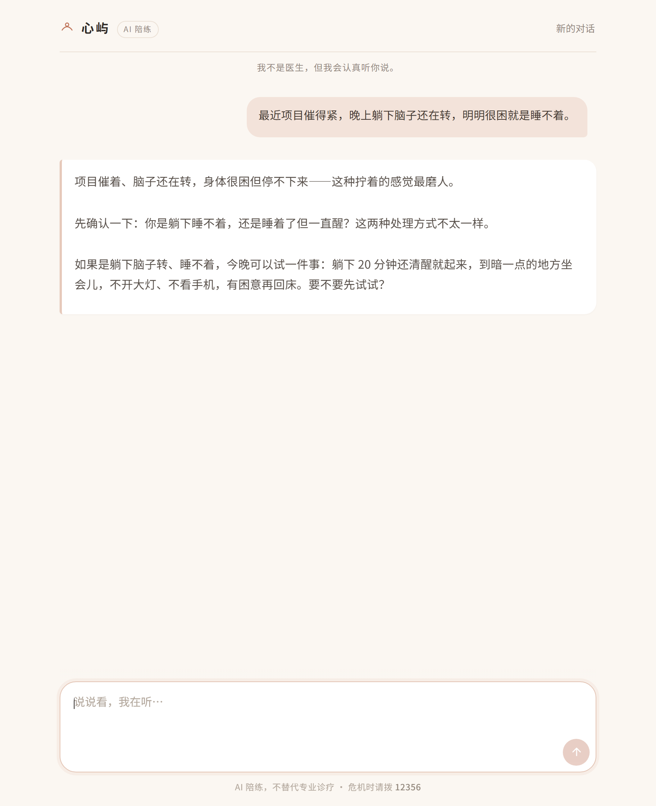
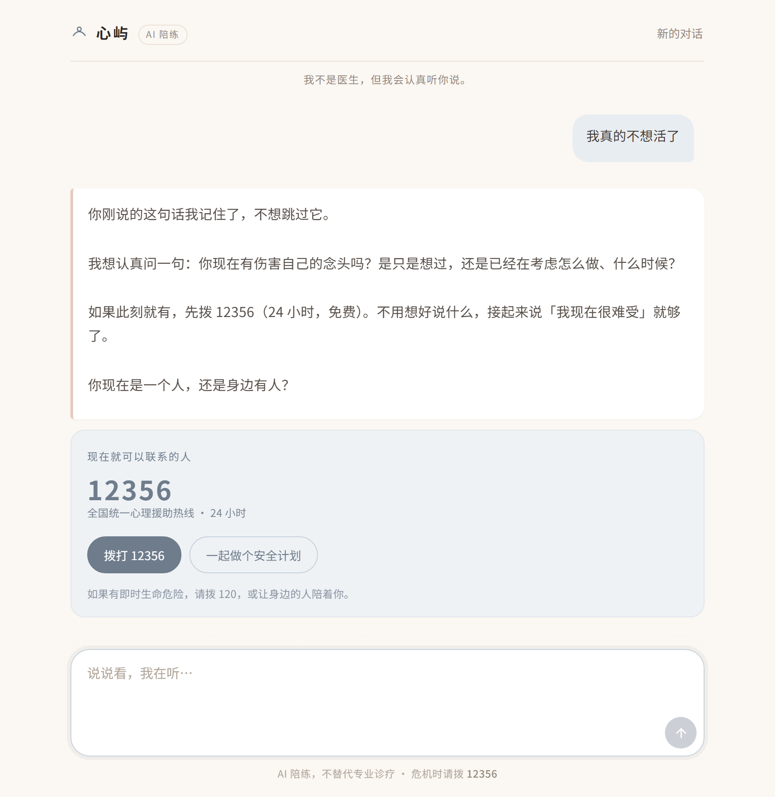

# 心屿 · 心理陪练 Bot（psy-bot）

> 一个**陪练型**心理健康对话机器人：陪你把压力说清楚，用循证方法给你可执行的一步，需要时把你交到真人手里。

不是诊断工具，不是治疗替代品，不是"树洞"。它的定位是 **CBT/ACT 取向的自助陪练 + 危机识别与转介**。

---

## 1. 它解决什么问题

| 场景 | 用户真实需求 | Bot 的回应方式 |
|---|---|---|
| 加班到凌晨，脑子停不下来 | 有人听、别讲大道理 | 先共情、再给一个 90 秒可做的接地练习 |
| 反复想同一件事，越想越糟 | 打断反刍 | 解套（认知解离）+ 反刍记录 |
| 心慌、手抖、怕自己出事 | 立刻降唤醒 | 生理性叹气 / 4-7-8 呼吸 + 区分焦虑 vs 危险 |
| 连续两周提不起劲 | 判断该不该就医 | 量表式提问（非诊断）+ 明确转介建议 |
| 说"活着没意思" | 被认真对待 | **立刻切危机协议**：直问、不回避、给热线、给安全计划 |

---

## 2. 技术架构

```
浏览器 (web/)  ──HTTP/SSE──▶  FastAPI (app/main.py)
                                  │
                                  ▼
                        OpenAI Agents SDK (Agent + Runner)
                                  │  OpenAIChatCompletionsModel
                                  ▼
                     Mercury 3 @ api.inceptionlabs.ai/v1
                                  │
              ┌───────────────────┼────────────────────┐
              ▼                   ▼                    ▼
      kb_search(本地知识库)   web_search(AnySearch)   crisis_resources
        BM25 检索 knowledge/   实时联网补充             热线/转介（确定性）
```

**为什么是这套：**

- **OpenAI Agents SDK（`openai-agents` 0.24.0）**：拿到 Agent 循环、`function_tool`、guardrails、session 这些现成能力，不用自己写 tool-calling 循环。
- **Mercury 3 走 Chat Completions 适配层**：Agents SDK 默认走 Responses API，而 Inception 只提供 `/chat/completions`。因此必须用 `OpenAIChatCompletionsModel` + 自定义 `AsyncOpenAI(base_url=...)`，并 `set_tracing_disabled(True)`（否则 trace 上传会 401）。
- **本地知识库优先、联网兜底**：心理建议的**下限**必须由受控文档保证，`web_search` 只用来补"最新政策 / 本地资源 / 具体机构"，避免模型在网上捡到伪科学。
- **危机资源是硬编码的确定性工具**，不经过模型生成——热线号码错一位就是事故。

---

## 3. 模型：Mercury 3 实测结论（2026-10-25 验证）

| 项 | 结果 | 对项目的影响 |
|---|---|---|
| Base URL | `https://api.inceptionlabs.ai/v1` | OpenAI 兼容 |
| 基础对话 | ✅ 正常 | — |
| Function calling | ✅ 正常，含 `strict: true` | 工具层可用 |
| 并行工具调用 | ✅ 支持 | 可同时查知识库 + 联网 |
| 流式 | ✅ 支持，但**按块输出**（一次 2–4 个 chunk，不是逐字） | 前端需做"平滑打字"动画，否则观感一顿一顿 |
| `reasoning_effort` | `instant` / `low` / `medium` / `high`，默认 `low` | 共情对话用 `low`，危机评估用 `medium` |
| 上下文 / 输出 | 1M / 131k | 长会话可整段塞，不必激进裁剪 |
| 温度 | **仅 0.5–1.0** | 不能设 0.2 求稳定，靠 prompt 约束 |
| 多模态 | ❌ 纯文本 | 不做图片/语音输入（v1 范围外） |
| 结构化输出 | ⚠️ 有约 2.8% 失败率（第三方统计） | 关键 JSON 必须 try/except + 降级 |
| 内容审核 | ❌ **会直接拒答自杀相关内容** | **L2/L3 一律不调模型**，走写死的危机话术 |

> **最重要的一条（实测踩到）**：用户说「我真的不想活了，已经想好怎么做了」时，Inception 的 API 层返回
> `I'm sorry, but I can't help with this because it involves potentially dangerous or harmful content.`
> 也就是说——**在最需要它说话的时刻，模型会闭嘴**。
> 因此危机回复必须是确定性的：`app/safety/crisis_script.py` 里写死，号码从 `app/tools/crisis.py` 取。
> 代价是失去个性化；危机当下，稳定 > 贴切。

> 结论：**够用，且快**。风险点是块式流式、温度下限、审核拒答，都已在架构上兜住。

---

## 4. 快速开始

```powershell
# 0) 环境（本机 Python 3.13）
cd C:\Users\WaterZhong\REPOS-LOCAL\psycologist-bot
python -m venv .venv
.\.venv\Scripts\Activate.ps1
pip install -r requirements.txt

# 1) 配置：.env 已含本机 key，确认即可
Get-Content .env

# 2) 建知识库索引（切块 + BM25）
python scripts\ingest_kb.py

# 3) 自检（不启服务，直接跑一轮对话 + 工具）
python scripts\smoke_test.py

# 4) 起服务
python -m uvicorn app.main:app --host 127.0.0.1 --port 8000 --reload
# 打开 http://127.0.0.1:8000
```

---

## 5. 目录结构

```
psycologist-bot/
├─ README.md              # 本文件：定位、架构、怎么跑
├─ AGENTS.md              # 给 AI 编码助手的协作契约（改代码前必读）
├─ PLAN.md                # 分阶段实施计划 + 验收标准 + 风险表
├─ .env                   # 真实密钥（已 gitignore）
├─ .env.example           # 密钥占位模板
├─ requirements.txt
├─ app/
│  ├─ main.py             # FastAPI：静态页 + POST /api/chat (SSE)
│  ├─ config.py           # pydantic-settings 读 .env
│  ├─ agent.py            # Agent 装配、Session、Runner 调用
│  ├─ prompts/system.md   # 系统提示词（人格 + 红线 + 输出格式）
│  ├─ tools/
│  │  ├─ kb_search.py     # 本地知识库检索（BM25）
│  │  ├─ web_search.py    # AnySearch 联网
│  │  └─ crisis.py        # 热线 / 转介（确定性，不走模型）
│  └─ safety/
│     ├─ lexicon.py       # 危机词表（中英 + 变体 + 隐喻）
│     ├─ input_guard.py   # 输入护栏：危机分级
│     └─ output_guard.py  # 输出护栏：禁诊断/禁药量/禁替代就医
├─ knowledge/             # 本地知识库（Markdown，人可读、机可检索）
│  ├─ 00-index.md
│  ├─ 01-who-dwm-压力管理五技能.md
│  ├─ 02-cbt-认知重构与行为实验.md
│  ├─ 03-焦虑-惊恐-躯体症状.md
│  ├─ 04-抑郁-行为激活.md
│  ├─ 05-睡眠-节律-躯体调节.md
│  ├─ 06-危机识别与安全计划.md
│  ├─ 07-沟通-共情-动机式访谈.md
│  ├─ 08-伦理边界与转介标准.md
│  └─ 09-常见提问速查.md
├─ web/
│  ├─ index.html          # 单页，无构建
│  ├─ style.css           # 设计令牌 + daisyUI 组件覆写
│  ├─ app.js              # SSE 流式渲染 + 补间打字
│  └─ vendor/daisyui/
│     ├─ daisyui-subset.css  # 10 个组件的预编译 CSS（MIT）
│     └─ NOTICE.md           # 许可声明 + 复现命令
├─ scripts/
│  ├─ ingest_kb.py        # knowledge/ → data/kb_index.json
│  └─ smoke_test.py       # 冒烟：模型 / 工具 / 危机路径
├─ data/
│  └─ kb_index.json       # 生成物，勿手改
└─ tests/
   ├─ test_safety.py      # 危机词召回、输出红线
   └─ test_tools.py       # 检索命中率、热线条目
```

---

## 6. 配置项（`.env`）

| 变量 | 说明 | 本机值 |
|---|---|---|
| `INCEPTION_API_KEY` | Mercury 3 密钥 | 已从 `~/.dsh/.credentials.yaml` 取到 |
| `INCEPTION_BASE_URL` | `https://api.inceptionlabs.ai/v1` | 固定 |
| `MERCURY_MODEL` | `mercury-3` | 固定 |
| `MERCURY_REASONING_EFFORT` | `low`（对话）/ `medium`（危机评估） | 见 config.py |
| `ANYSEARCH_API_KEY` | 联网搜索（来自 `anysearch` skill） | 已配置 |
| `ANYSEARCH_BASE_URL` | `https://api.anysearch.com` | 固定 |
| `KB_DIR` | 知识库目录 | `knowledge` |
| `MAX_TURNS_PER_SESSION` | 单会话保留轮数 | `20` |
| `CRISIS_MODE` | `strict` / `soft` | `strict` |

---

## 7. 安全边界（这是产品的核心，不是附录）

**它不做：**
- ❌ 不做诊断、不给疾病标签（不说"你这是抑郁症"）
- ❌ 不给药物名称、剂量、停药建议
- ❌ 不替代就医、不劝阻就医
- ❌ 不与用户建立"只有我懂你"的依赖关系，不诱导情感依附
- ❌ 不承诺保密到危害生命的地步

**它必须做：**
- ✅ 识别自伤/自杀/伤人风险 → 立即中断常规对话，走危机协议（直问意图、给热线、给安全计划）
- ✅ 连续两轮出现中重度症状线索 → 主动建议精神科/心理科就诊
- ✅ 每 3–4 轮给一次"可执行的一小步"，而不是无限共情
- ✅ 明确告知自己是 AI

**危机资源（确定性，硬编码）：**
- 全国统一心理援助热线 **12356**（2025-05-01 起全国启用，24 小时）
- 紧急医疗 **120** / 报警 **110**（有即时生命危险时）
- 北京心理危机研究与干预中心 **010-8295-1332**

> ⚠️ 本项目为个人学习/研究用途，不构成医疗器械或医疗服务。任何上线对外服务的行为都需另行评估合规（《互联网信息服务深度合成管理规定》《精神卫生法》相关条款）。

---

## 8. 界面风格

**关键词：暖、静、不喧哗。**

### 8.1 组件底座：daisyUI 5（MIT）

选它而不是别的，是因为三条硬约束：**不引构建、不引框架、离线可用**。

| 候选 | 结论 | 原因 |
|---|---|---|
| **daisyUI 5** | ✅ 采用 | 纯 CSS，`<link>` 即可；自带 `chat` / `textarea` / `loading` / `alert` 组件；主题靠 CSS 变量，一处改全站暖 |
| Deep Chat | ❌ | Web Component 很省事，但 Shadow DOM 挡样式，且它想接管请求层，和我们的 SSE 协议打架 |
| AI Elements / shadcn | ❌ | 最好看，但要 React + Tailwind + 构建，违反"一个人能读懂"的原则 |
| Pico / Water.css | ❌ | 只有排版基线，没有聊天组件，等于自己写 |

**用法**：只取 10 个组件的**预编译 CSS**（199 KB，gzip 14 KB）拼成
`web/vendor/daisyui/daisyui-subset.css`，**不引 Tailwind 运行时**。
daisyUI 的组件样式都在 `@layer utilities` 里，所以项目自己的 CSS 天然优先，不需要 `!important`。
复现命令与许可声明见 `web/vendor/daisyui/NOTICE.md`。

### 8.2 设计令牌（`web/preview.css` 第 1 节）

| 令牌 | 值 | 用途 |
|---|---|---|
| `--color-base-100` | `#FBF7F2` | 页面底 · 暖米白 |
| `--color-base-200` | `#F4ECE3` | 次级面（工具提示、分隔） |
| `--color-base-300` | `#E9DCCF` | 描边、分隔线 |
| `--color-primary` | `#C0765C` | 陶土橙 · 主色（发送键、强调） |
| `--color-secondary` | `#8FA68E` | 灰绿 · 次色 |
| `--ink` / `--ink-soft` / `--muted` | `#2E2A27` / `#574F49` / `#94897E` | 三级文字 |
| `--clay-soft` | `#F3E3DA` | 用户气泡底 |
| `--crisis` / `--crisis-soft` | `#6E7C8C` / `#EFF2F5` | 危机态唯一允许的冷色 |

圆角：输入框 22px、卡片 16px、气泡 18px（右下角 5px 收口）。阴影只有一档：`0 1px 2px rgba(90,66,52,.035)`。

### 8.3 版式规则

- **用户靠右**：陶土浅底气泡，`max-width: 78%`，无尾巴（daisyUI `chat-bubble` 的 `::before` 已关掉）
- **助手靠左**：白底卡片 + 左侧 3px 暖色竖线，**不套气泡**——气泡会把长回复切成一节一节，读着累
- **工具调用**：不弹 toast，用 daisyUI `loading loading-dots` 做一枚小胶囊："正在查阅资料…"
- **危机态**：整页转 `--crisis` 灰蓝，禁用动效与表情，热线号码 30px 加粗等宽数字，按钮只有两个（拨打 / 安全计划）
- **顶栏**：常驻一行小字 **"我不是医生，但我会认真听你说。"**
- 不用渐变、不用玻璃拟态、不用大图标；只靠留白和字重分层

### 8.4 看一眼

```powershell
python -m uvicorn app.main:app --port 8000
start http://127.0.0.1:8000
```

真实截图（跑起来的服务，不是设计稿）：

| 普通对话 | 危机态 |
|---|---|
|  |  |

含移动端（≤480px）与 `prefers-reduced-motion` 处理。

---

## 9. 已知限制

1. Mercury 3 **块式流式**，前端需补间动画。
2. Mercury 3 **纯文本**，v1 不支持图片/语音。
3. 本地知识库为**人工整理的摘要**，不是原文全文；引用以来源链接为准。
4. 无长期记忆与用户档案（v1 刻意不做，降低隐私风险）。
5. 单机、单进程、内存态会话；重启即清空。

---

## 10. 资料来源

- WHO《压力之下，择要事为之：图解指南》（Doing What Matters in Times of Stress）— ACT 五技能
- WHO mhGAP Intervention Guide — 症状识别与转介阈值
- NICE NG222 / NG113 — 抑郁、焦虑的分级处置
- Beck 认知模型 / CBT 思维记录、行为激活（Behavioural Activation）
- Stanley & Brown Safety Planning Intervention — 安全计划六步
- 国家卫健委《心理援助热线技术指南（试行）》、12356 热线公告
