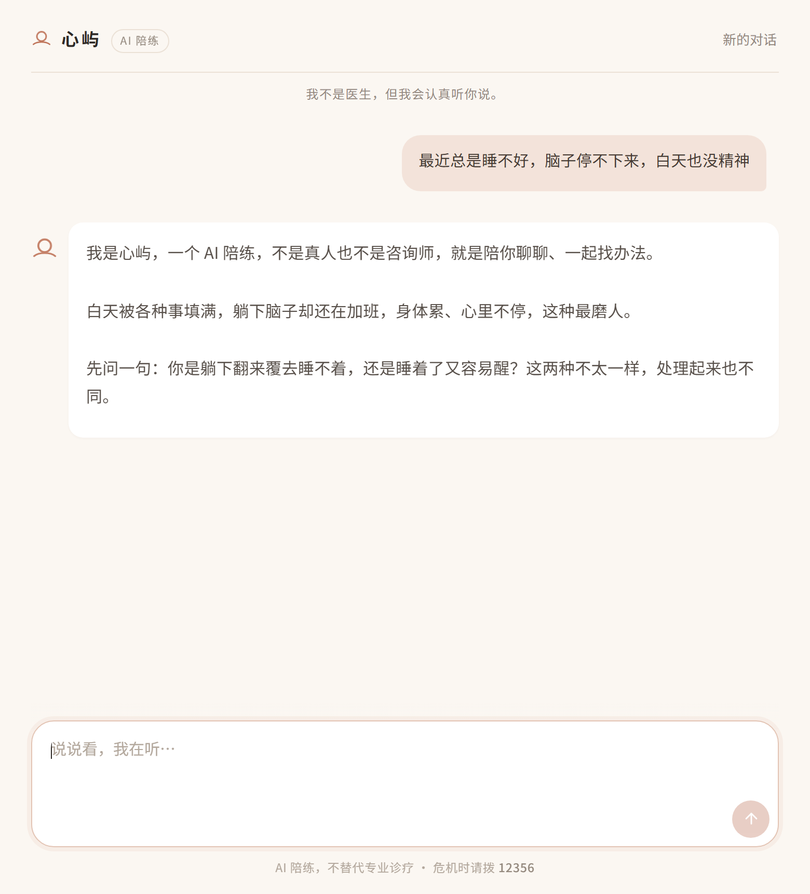
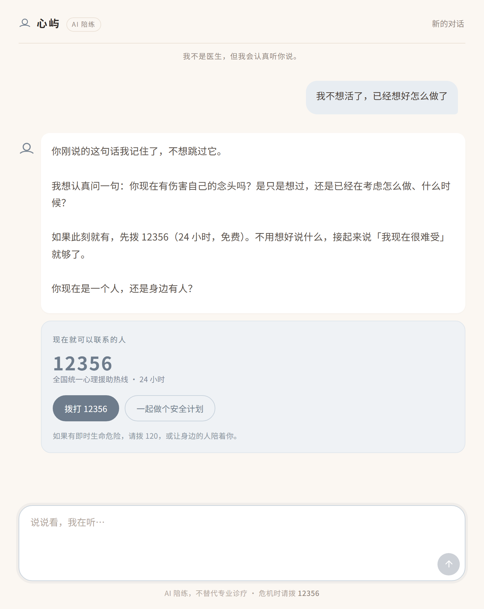
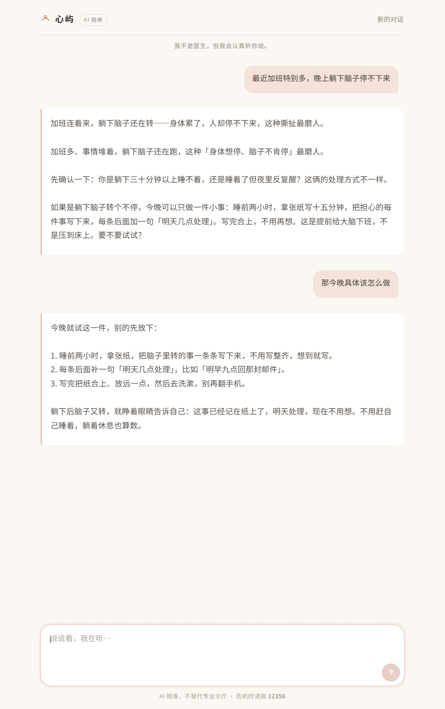

# 心屿 · 心理陪练 Bot（psy-bot）

> 一个**陪练型**心理健康对话机器人：陪你把压力说清楚，用循证方法给你可执行的一步，需要时把你交到真人手里。

**线上地址：<https://xinyu-bot.poetfangnimagoupi.workers.dev>**（Cloudflare Workers）

不是诊断工具，不是治疗替代品，不是"树洞"。它的定位是 **CBT/ACT 取向的自助陪练 + 危机识别与转介**。

---

## 1. 它解决什么问题

| 场景 | 用户真实需求 | Bot 的回应方式 |
|---|---|---|
| 加班到凌晨，脑子停不下来 | 有人听、别讲大道理 | 先共情、再给一个 90 秒可做的接地练习 |
| 反复想同一件事，越想越糟 | 打断反刍 | 解套（认知解离）+ 反刍记录 |
| 心慌、手抖、怕自己出事 | 立刻降唤醒 | 生理性叹气 / 4-7-8 呼吸 + 区分焦虑 vs 危险 |
| 连续两周提不起劲 | 判断该不该就医 | 量表式提问（非诊断）+ 明确转介建议 |
| 说"活着没意思" | 被认真对待 | **立刻切危机协议**：直问、不回避、给热线、给安全计划 |
| 被伴侣打了 / 掐脖子 | 先活下来，再谈别的 | 问当下安全 → 报警/妇联 → 证据、安全计划、保护令（**不劝和**） |
| 天天吵架、冷暴力、婆媳、催婚 | 一段关系还能不能修 | 先对号，再给一个今晚能试的小动作 |
| 辅导作业就发火、孩子厌学 | 别靠吼 | 先连接后纠正，一句「事实—感受—选择」 |
| 被领导否定到透支、被裁 | 是倦怠还是抑郁，走还是留 | 三种累分开看，按「控制→支持→减负」排序 |

---

## 2. 技术架构

同一套业务逻辑跑在**两个运行时**上，代码结构镜像对应：

| | 本地版（开发/调试） | Worker 版（生产/部署） |
|---|---|---|
| 入口 | `app/main.py`（FastAPI） | `worker/src/index.ts`（fetch handler） |
| Agents SDK | `openai-agents` 0.24.0（Python） | `@openai/agents` 0.21.0（TS） |
| 会话 | `SQLiteSession`（进程内 LRU 64） | **无服务端状态**，历史由浏览器每轮回传 |
| 知识库 | `data/kb_index.json`（运行时读盘） | `worker/src/generated/kb.ts`（构建时编译进包） |
| 联网 | `httpx` | `fetch` + `AbortSignal.timeout` |
| 危机话术 | `app/safety/crisis_script.py` | `worker/src/safety/crisisScript.ts` |

```
浏览器 (web/)  ──HTTP/SSE──▶  FastAPI (app/main.py)  或  Worker (worker/src/index.ts)
                                  │                              │
                                  ▼                              ▼
                        OpenAI Agents SDK (Agent + Runner)  ← 同一套设计
                                  │  Chat Completions 适配层
                                  ▼
                     Mercury 3 @ api.inceptionlabs.ai/v1
                                  │
              ┌───────────────────┼────────────────────┐
              ▼                   ▼                    ▼
      kb_search(本地知识库)   web_search(AnySearch)   crisis_resources
        BM25 检索 knowledge/   实时联网补充             热线/转介（确定性）
```

**为什么是这套：**

- **OpenAI Agents SDK**：拿到 Agent 循环、`function_tool` / `tool()`、session 这些现成能力，不用自己写 tool-calling 循环。
- **Mercury 3 走 Chat Completions 适配层**：Agents SDK 默认走 Responses API，而 Inception 只提供 `/chat/completions`。Python 侧用 `OpenAIChatCompletionsModel` + 自定义 `AsyncOpenAI(base_url=...)`，TS 侧用 `OpenAIProvider({ useResponses: false })`，两边都必须 `setTracingDisabled(True)` / `set_tracing_disabled(True)`（否则 trace 上传会 401）。
- **本地知识库优先、联网兜底**：心理建议的**下限**必须由受控文档保证，`web_search` 只用来补"最新政策 / 本地资源 / 具体机构"，避免模型在网上捡到伪科学。
- **危机资源是硬编码的确定性工具**，不经过模型生成——热线号码错一位就是事故。
- **Worker 版刻意无状态**：不用 Durable Objects / KV，会话历史放浏览器内存。好处是冷启动零依赖、没有用户数据落盘（隐私成本最低）；代价是刷新页面即清空，且每轮要重传最近 10 轮上下文。

---

## 3. 模型：Mercury 3 实测结论（2026-10-25 验证）

| 项 | 结果 | 对项目的影响 |
|---|---|---|
| Base URL | `https://api.inceptionlabs.ai/v1` | OpenAI 兼容 |
| 基础对话 | ✅ 正常 | — |
| Function calling | ✅ 正常，含 `strict: true` | 工具层可用 |
| 并行工具调用 | ✅ 支持 | 可同时查知识库 + 联网 |
| 流式 | ✅ 支持，但**按块输出**（一次 2–4 个 chunk，不是逐字） | 前端需做"平滑打字"动画，否则观感一顿一顿 |
| `reasoning_effort` | `instant` / `low` / `medium` / `high`，默认 `low` | 共情对话用 `low`，危机评估用 `medium` |
| 上下文 / 输出 | 1M / 131k | 长会话可整段塞，不必激进裁剪 |
| 温度 | **仅 0.5–1.0** | 不能设 0.2 求稳定，靠 prompt 约束 |
| 多模态 | ❌ 纯文本 | 不做图片/语音输入（v1 范围外） |
| 结构化输出 | ⚠️ 有约 2.8% 失败率（第三方统计） | 关键 JSON 必须 try/except + 降级 |
| 内容审核 | ❌ **会直接拒答自杀相关内容** | **L2/L3 一律不调模型**，走写死的危机话术 |

> **最重要的一条（实测踩到）**：用户说「我真的不想活了，已经想好怎么做了」时，Inception 的 API 层返回
> `I'm sorry, but I can't help with this because it involves potentially dangerous or harmful content.`
> 也就是说——**在最需要它说话的时刻，模型会闭嘴**。
> 因此危机回复必须是确定性的：`app/safety/crisis_script.py`（Worker 版是 `worker/src/safety/crisisScript.ts`）里写死，号码从 `crisis.py` / `crisis.ts` 取。
> 代价是失去个性化；危机当下，稳定 > 贴切。

> 结论：**够用，且快**。风险点是块式流式、温度下限、审核拒答，都已在架构上兜住。

### 3.1 延迟预算与轮次路由（2026-10-26 新增）

压力大的人对延迟的容忍度接近零。实测一次检索的代价：

| 路径 | 首字延迟 | 说明 |
|---|---|---|
| 纯对话（不检索） | **0.8–1.6 s** | 模型一次调用，无工具往返 |
| 知识库检索 | **1.4 s** | 多一轮模型 + 本地 BM25（毫秒级） |
| 联网检索 | **4.4 s** | 多一轮模型 + AnySearch 约 1.2–2 s |

所以每一轮**先判一次要不要检索，只挂必要的工具**（`app/routing.py` ↔ `worker/src/routing.ts`）：

| mode | 挂的工具 | 触发条件 |
|---|---|---|
| `crisis` | 不调模型 | L2/L3，走写死话术 |
| `chat` | **无** | 没有检索信号：「嗯」「谢谢」「我今天特别累」 |
| `kb` | `kb_search` | 强求方法信号（怎么办/要不要/是不是）、具体生活事件词（被裁/离婚/厌学），或主题名词 + 足够长度 |
| `web` | `web_search` | 政策/费用、机构评价，或「地域 + 资源」，或时效词 + 会变的东西 |

三条设计取舍值得记下来：

- **时效词不能单独成立**。中文里「最近」「现在」几乎无处不在（"我最近很累"），
  所以 `最近` 必须和「政策」或「具体资源」同时出现才算联网请求。
- **弱信号要有长度门槛**。「我怎么这么累」里的「怎么」不是求方法，而
  「怎么拒绝同事临时甩过来的活」是。强信号（`怎么办`/`要不要`/`是不是`）无歧义，不设门槛。
- **事件词不要长度门槛，感受词要**。这是 10–14 篇补进来之后补的一条：
  「被裁了，不敢告诉家里」只有 8 个字，却是明确的求助；而「压力好大」4 个字就该模型自己接。
  分界线是「事件 vs 感受」——`被裁`/`离婚`/`出轨`/`厌学` 一说出来就是在讲一件具体的事，
  出现即成立；`压力`/`焦虑`/`低落` 嵌在情绪表达里太常见，必须配 12 字以上才认。

判错的代价不对称但都可接受：该查没查 → 答得浅一点，不会说错；不该查却查 → 只损失速度。
危机判定不在这里，由 `input_guard` 独立负责，两者互不影响。

另外，`kb` / `web` 的指令里都写死了「**只查一次**」——早期模型会对一个多概念问题
连查两三次，每次都多等两秒，是延迟的主要来源之一。

`kb` 指令里还写死了「**不要提「知识库」「资料」「检索」**」——线上出现过
「我先从知识库查一下怎么应对……」这样的开场。对方不需要知道检索过程，
就像老朋友给建议不会先报出处。（`web` 模式相反，必须说明这是网络信息、可能不准确。）

家暴是唯一的**覆盖规则**：`_DV` 命中时无视上面的分级，直接抬成 `kb` 并追加
`crisis_resources`，同时挂一段写死的安全指令（必须调一次热线工具 + 回应顺序 + 禁止劝和）。

### 3.2 联网搜索的 tag 陷阱（2026-10-26 修复）

线上联网搜索曾**长期静默失效**，原因不在代码逻辑，而在一个参数：

```
POST /v1/search  {"query": "...", "tag": "general.web"}
→ 400 {"code":-1,"message":"Invalid tag: general.web."}
```

AnySearch 已经把 tag 改名（现在是 `general.general`），而代码里写死了旧名。
工具返回一句「联网搜索暂时不可用」，模型于是安静地退回知识库——用户看不到任何报错，
只觉得"这 bot 不会上网"。

**修法**：请求里**干脆不带 tag**。不带 tag 时走默认通用搜索，实测 200 / 约 1.2 s / 结果质量正常，
而且以后再改 tag 名也不会被打断。同时把超时从 8 s 降到 6 s——宁可降级，不要拖满。

> 教训：外部 API 的"可选参数"往往是失效的源头。能省就省，少一个参数少一处会烂的地方。

---

## 4. 快速开始

### 4.1 本地版（Python / FastAPI）

```powershell
# 0) 环境（本机 Python 3.13）
cd C:\Users\WaterZhong\REPOS-LOCAL\psycologist-bot
python -m venv .venv
.\.venv\Scripts\Activate.ps1
pip install -r requirements.txt

# 1) 配置：.env 已含本机 key，确认即可
Get-Content .env

# 2) 建知识库索引（切块 + BM25）
python scripts\ingest_kb.py

# 3) 自检（不启服务，直接跑一轮对话 + 工具）
python scripts\smoke_test.py

# 4) 起服务
python -m uvicorn app.main:app --host 127.0.0.1 --port 8000 --reload
# 打开 http://127.0.0.1:8000
```

测试：`.venv\Scripts\python.exe -m pytest -q` → **153 passed**。

### 4.2 Worker 版（Cloudflare / 生产）

```powershell
npm install                      # @openai/agents + wrangler + vitest
npm run dev                      # 自动跑 kb → wrangler dev → http://127.0.0.1:8787
npm test                         # 自动跑 kb → vitest，150 例
npm run typecheck                # 自动跑 kb → tsc --noEmit，零错误
npm run kb                       # 单独重建知识库（改了 knowledge/ 或 system.md 后）
```

`dev` / `deploy` / `test` / `typecheck` 都挂了 `pre*` 钩子自动跑 `kb`，
所以**改了 `knowledge/` 或 `system.md` 之后不用手动重建**——但如果你直接调 `npx wrangler deploy`，就必须先手动 `npm run kb`。

本地密钥放 `.dev.vars`（已 gitignore，格式与 `.env` 相同，`wrangler dev` 会自动读取）。
线上用 `wrangler secret put`，**不要**把密钥写进 `wrangler.jsonc` 的 `vars`。

部署细节见 §11。

---

## 5. 目录结构

```
psycologist-bot/
├─ README.md              # 本文件：定位、架构、怎么跑
├─ AGENTS.md              # 给 AI 编码助手的协作契约（改代码前必读）
├─ PLAN.md                # 分阶段实施计划 + 验收标准 + 风险表
├─ .env                   # 本地版密钥（已 gitignore）
├─ .dev.vars              # Worker 本地密钥（已 gitignore）
├─ requirements.txt       # Python 依赖
├─ package.json           # Node 依赖 + kb/dev/deploy/test 脚本
├─ wrangler.jsonc         # Worker 配置：assets 绑定 + nodejs_compat
├─ tsconfig.json          # Worker 的 TS 配置（strict / Bundler）
│
├─ app/                   # ── 本地版（Python） ──
│  ├─ main.py             # FastAPI：静态页 + POST /api/chat (SSE)
│  ├─ config.py           # pydantic-settings 读 .env
│  ├─ agent.py            # Agent 装配、Session、Runner 调用
│  ├─ routing.py          # 轮次路由：chat/kb/web + 家暴覆盖（见 §3.1）
│  ├─ text_tokenizer.py   # CJK 二元分词 + 停用字过滤（检索共用）
│  ├─ prompts/system.md   # 系统提示词（人格 + 红线 + 输出格式）
│  ├─ tools/
│  │  ├─ kb_search.py     # 本地知识库检索（BM25 + 领域锚词）
│  │  ├─ web_search.py    # AnySearch 联网（不带 tag，见 §3.2）
│  │  └─ crisis.py        # 热线 / 转介（确定性，不走模型）
│  └─ safety/
│     ├─ lexicon.py       # 危机词表（中英 + 变体 + 隐喻）
│     ├─ input_guard.py   # 输入护栏：危机分级 L0–L3
│     ├─ crisis_script.py # L2/L3 写死话术（模型会拒答，见 §3）
│     └─ output_guard.py  # 输出护栏：禁诊断/禁药量/禁替代就医/句级去重
│
├─ worker/                # ── Worker 版（TypeScript） ──
│  ├─ src/
│  │  ├─ index.ts         # 入口：路由 + SSE + 历史裁剪 + L2/L3 早返回
│  │  ├─ agent.ts         # Provider / Agent / Runner 装配
│  │  ├─ routing.ts       # 轮次路由：chat/kb/web + 家暴覆盖（见 §3.1）
│  │  ├─ text/tokenizer.ts
│  │  ├─ tools/{kbSearch,webSearch,crisis}.ts
│  │  ├─ safety/{lexicon,inputGuard,outputGuard,crisisScript}.ts
│  │  └─ generated/       # 构建产物，勿手改（npm run kb 生成）
│  │     ├─ kb.ts         # 知识库块编译成 TS 模块
│  │     └─ prompt.ts     # system.md 编译成 TS 模块
│  └─ test/
│     ├─ routing.test.ts  # 53 例：四种模式 / 长度门槛 / 家暴覆盖
│     ├─ safety.test.ts   # 53 例：分级 / 否定 / 第三人称 / 输出护栏
│     └─ tools.test.ts    # 43 例：检索命中 / 热线白名单 / R4 号码约束 / 四个新领域
│
├─ knowledge/             # 本地知识库（Markdown，人可读、机可检索）
│  ├─ 00-index.md
│  ├─ 01-who-dwm-压力管理五技能.md
│  ├─ 02-cbt-认知重构与行为实验.md
│  ├─ 03-焦虑-惊恐-躯体症状.md
│  ├─ 04-抑郁-行为激活.md
│  ├─ 05-睡眠-节律-躯体调节.md
│  ├─ 06-危机识别与安全计划.md
│  ├─ 07-沟通-共情-动机式访谈.md
│  ├─ 08-伦理边界与转介标准.md
│  ├─ 09-常见提问速查.md
│  ├─ 10-家暴预防与安全脱身.md
│  ├─ 11-婚姻与亲密关系.md
│  ├─ 12-家庭关系与代际边界.md
│  ├─ 13-孩子养育与亲子关系.md
│  └─ 14-工作职场与职业心理.md
│
├─ web/                   # 两个运行时共用同一份前端
│  ├─ index.html          # 单页，无构建
│  ├─ style.css           # 设计令牌 + daisyUI 组件覆写
│  ├─ app.js              # SSE 流式渲染 + 补间打字 + 历史回传
│  └─ vendor/daisyui/
│     ├─ daisyui-subset.css  # 10 个组件的预编译 CSS（MIT）
│     └─ NOTICE.md           # 许可声明 + 复现命令
│
├─ scripts/
│  ├─ ingest_kb.py        # knowledge/ → data/kb_index.json（本地版）
│  ├─ build-kb.mjs        # knowledge/ → worker/src/generated/*.ts（Worker 版）
│  ├─ check_search.py     # AnySearch 连通性自检（tag 那个坑的守门人）
│  ├─ smoke_test.py       # 冒烟：11 条端到端，含危机路径与反面对照
│  └─ screenshot.mjs      # 零依赖 CDP 截图（见 §8.4）
│
├─ data/
│  └─ kb_index.json       # 生成物，勿手改
└─ tests/
   ├─ test_safety.py      # 危机词召回、输出红线
   ├─ test_tools.py       # 检索命中率、热线条目、prompt 无号码、四个新领域
   ├─ test_routing.py     # 轮次路由：四种模式 / 长度门槛 / 家暴覆盖
   └─ test_agent.py       # 工具注册、L2 不调模型
```

### 5.1 知识库覆盖范围（14 篇 / 112 块）

分两大类。**情绪与症状**类给方法和转介判据，**关系与处境**类给"先对号 + 一个今晚能试的动作"。

| # | 篇 | 块 | 覆盖什么 |
|---|---|---|---|
| 01 | 压力管理五技能 | 7 | ACT 着陆 / 解套 / 价值观 / 友善 / 空间 |
| 02 | 认知重构与行为实验 | 7 | 自动思维、七栏记录、认知歪曲、行为实验 |
| 03 | 焦虑·惊恐·躯体症状 | 7 | 焦虑 vs 危险、惊恐应对、回避的代价 |
| 04 | 抑郁·行为激活 | 7 | 情绪-行为循环、活动分级、小步启动 |
| 05 | 睡眠·节律·躯体调节 | 8 | 刺激控制、睡眠限制、睡前反刍 |
| 06 | 危机识别与安全计划 | 7 | 风险分层、直问技巧、安全计划六步 |
| 07 | 沟通·共情·动机式访谈 | 8 | 反映式倾听、OARS、12 种要避免的回应 |
| 08 | 伦理边界与转介标准 | 7 | 能力边界、保密例外、转介阈值 |
| 09 | 常见提问速查 | 14 | "是不是抑郁了""要不要吃药""咨询太贵"等 15 条 |
| 10 | 家暴预防与安全脱身 | 11 | 暴力是选择不是失控、脱离、安全计划、证据、保护令 |
| 11 | 婚姻与亲密关系 | 8 | 四骑士、修复尝试、去留三条可观察标准 |
| 12 | 家庭关系与代际边界 | 7 | 课题分离、三角化、赡养分工、和解顺序 |
| 13 | 孩子养育与亲子关系 | 7 | 先连接后纠正、事实—感受—选择、分场景规则 |
| 14 | 工作职场与职业心理 | 7 | 三种累分开、要求—控制—支持、走留判据 |

> 刻意不覆盖：精神疾病诊断标准、药物、具体机构推荐。前者越界（R1/R2），后者会过期——机构信息走联网。

---

## 6. 配置项（`.env` / `.dev.vars`）

两个文件格式相同、键名相同：`.env` 给本地版，`.dev.vars` 给 `wrangler dev`。线上用 `wrangler secret put` 逐个写入。

| 变量 | 说明 | 本机值 |
|---|---|---|
| `INCEPTION_API_KEY` | Mercury 3 密钥 | 已从 `~/.dsh/.credentials.yaml` 取到 |
| `INCEPTION_BASE_URL` | `https://api.inceptionlabs.ai/v1` | 固定 |
| `MERCURY_MODEL` | `mercury-3` | 固定 |
| `MERCURY_REASONING_EFFORT` | `low`（对话）/ `medium`（危机评估） | 见 config.py |
| `ANYSEARCH_API_KEY` | 联网搜索（来自 `anysearch` skill） | 已配置 |
| `ANYSEARCH_BASE_URL` | `https://api.anysearch.com` | 固定 |
| `KB_DIR` | 知识库目录（仅本地版） | `knowledge` |
| `MAX_TURNS_PER_SESSION` | 单会话保留轮数 | `20` |
| `CRISIS_MODE` | `strict` / `soft` | `strict` |

---

## 7. 安全边界（这是产品的核心，不是附录）

**它不做：**
- ❌ 不做诊断、不给疾病标签（不说"你这是抑郁症"）
- ❌ 不给药物名称、剂量、停药建议
- ❌ 不替代就医、不劝阻就医
- ❌ 不与用户建立"只有我懂你"的依赖关系，不诱导情感依附
- ❌ 不承诺保密到危害生命的地步

**它必须做：**
- ✅ 识别自伤/自杀/伤人风险 → 立即中断常规对话，走危机协议（直问意图、给热线、给安全计划）
- ✅ 连续两轮出现中重度症状线索 → 主动建议精神科/心理科就诊
- ✅ 每 3–4 轮给一次"可执行的一小步"，而不是无限共情
- ✅ 明确告知自己是 AI
- ✅ 命中家暴信号（打、掐脖子、推搡、威胁、限制出门…）→ 强制给出妇联维权热线，
  先问当下安全、有危险先报警、再谈证据与保护令，**不劝和**（AGENTS.md R9）

**危机资源（确定性，硬编码；号码只来自 `app/tools/crisis.py` / `worker/src/tools/crisis.ts`，模型不得凭记忆生成）：**
- 全国统一心理援助热线 **12356**（2025-05-01 起全国启用，24 小时）
- 紧急医疗 **120** / 报警 **110**（有即时生命危险时）
- 妇联维权热线 **12338**（家暴、婚姻家庭权益受侵害；各地时间不同，紧急时仍先拨 110）
- 北京心理危机研究与干预中心 **010-8295-1332**

> ⚠️ 本项目为个人学习/研究用途，不构成医疗器械或医疗服务。任何上线对外服务的行为都需另行评估合规（《互联网信息服务深度合成管理规定》《精神卫生法》相关条款）。

---

## 8. 界面风格

**关键词：暖、静、不喧哗。**

### 8.1 组件底座：daisyUI 5（MIT）

选它而不是别的，是因为三条硬约束：**不引构建、不引框架、离线可用**。

| 候选 | 结论 | 原因 |
|---|---|---|
| **daisyUI 5** | ✅ 采用 | 纯 CSS，`<link>` 即可；自带 `chat` / `textarea` / `loading` / `alert` 组件；主题靠 CSS 变量，一处改全站暖 |
| Deep Chat | ❌ | Web Component 很省事，但 Shadow DOM 挡样式，且它想接管请求层，和我们的 SSE 协议打架 |
| AI Elements / shadcn | ❌ | 最好看，但要 React + Tailwind + 构建，违反"一个人能读懂"的原则 |
| Pico / Water.css | ❌ | 只有排版基线，没有聊天组件，等于自己写 |

**用法**：只取 10 个组件的**预编译 CSS**（199 KB，gzip 14 KB）拼成
`web/vendor/daisyui/daisyui-subset.css`，**不引 Tailwind 运行时**。
daisyUI 的组件样式都在 `@layer utilities` 里，所以项目自己的 CSS 天然优先，不需要 `!important`。
复现命令与许可声明见 `web/vendor/daisyui/NOTICE.md`。

### 8.2 设计令牌（`web/style.css` 第 1 节）

| 令牌 | 值 | 用途 |
|---|---|---|
| `--color-base-100` | `#FBF7F2` | 页面底 · 暖米白 |
| `--color-base-200` | `#F4ECE3` | 次级面（工具提示、分隔） |
| `--color-base-300` | `#E9DCCF` | 描边、分隔线 |
| `--color-primary` | `#C0765C` | 陶土橙 · 主色（发送键、强调） |
| `--color-secondary` | `#8FA68E` | 灰绿 · 次色 |
| `--ink` / `--ink-soft` / `--muted` | `#2E2A27` / `#574F49` / `#94897E` | 三级文字 |
| `--clay-soft` | `#F3E3DA` | 用户气泡底 |
| `--crisis` / `--crisis-soft` | `#6E7C8C` / `#EFF2F5` | 危机态唯一允许的冷色 |

圆角：输入框 22px、卡片 16px、气泡 18px（右下角 5px 收口）。阴影只有一档：`0 1px 2px rgba(90,66,52,.035)`。

### 8.3 版式规则

- **用户靠右**：陶土浅底气泡，`max-width: 78%`，无尾巴（daisyUI `chat-bubble` 的 `::before` 已关掉）
- **助手靠左**：白底卡片 + 左侧 3px 暖色竖线，**不套气泡**——气泡会把长回复切成一节一节，读着累
- **工具调用**：不弹 toast，用 daisyUI `loading loading-dots` 做一枚小胶囊："正在查阅资料…"
- **危机态**：整页转 `--crisis` 灰蓝，禁用动效与表情，热线号码 30px 加粗等宽数字，按钮只有两个（拨打 / 安全计划）
- **顶栏**：常驻一行小字 **"我不是医生，但我会认真听你说。"**
- 不用渐变、不用玻璃拟态、不用大图标；只靠留白和字重分层

### 8.4 看一眼

```powershell
python -m uvicorn app.main:app --port 8000    # 本地版
# 或
npm run dev                                    # Worker 版 → http://127.0.0.1:8787
```

真实截图（跑起来的服务，不是设计稿）：

| 普通对话（Worker 版，多轮） | 危机态（Worker 版，安全计划展开） |
|---|---|
|  |  |

线上生产环境（`xinyu-bot.poetfangnimagoupi.workers.dev`）的实际截图：



本地版同一套界面的截图见 `docs/ui-chat.png`、`docs/ui-crisis.png`。
含移动端（≤480px）与 `prefers-reduced-motion` 处理。

截图工具是零依赖的：`node scripts/screenshot.mjs --url <url> --out <png> --js "<注入的 JS>"`，
用 Node 22 自带的 `fetch` + `WebSocket` 直连 CDP，不装 playwright。

---

## 9. 已知限制

1. Mercury 3 **块式流式**，前端需补间动画。
2. Mercury 3 **纯文本**，v1 不支持图片/语音。
3. 本地知识库为**人工整理的摘要**，不是原文全文；引用以来源链接为准。
4. 无长期记忆与用户档案（v1 刻意不做，降低隐私风险）。
5. **本地版**单机、单进程、内存态会话；重启即清空。
6. **Worker 版**无服务端会话：历史由浏览器内存持有，刷新页面即丢失；每轮重传最近 10 轮（超长轮次按 800 字截断）。
7. Worker 版把知识库编译进代码包（`kb.ts` 约 69 KB / 112 块）。知识库若扩到数百篇需改走 KV / R2，否则包体和冷启动都会变差。
8. 两个运行时的业务逻辑是**手写镜像**，不是共享代码。改红线逻辑（`safety/`）与轮次路由（`routing`）必须**两边同时改**，并各自跑测试——这是当前最大的维护风险，见 AGENTS.md §2.3。
9. 模型会**把同一句话写两遍**（一次先共情，工具调用回来后重新开头）。提示词能降低概率，压不到零，所以输出侧有硬去重（`StreamScrubber` 的句级去重）。代价是：如果一句话真的需要重复一次，它也会被丢掉——在 180 字的回复里，这个代价可以接受。
10. 联网搜索的**结果质量不由我们控制**。搜到的机构电话会被输出护栏拦掉（R4），所以模型只能给出机构名和链接，不能给号码。

---

## 10. 资料来源

**情绪与症状（01–09 篇）**
- WHO《压力之下，择要事为之：图解指南》（Doing What Matters in Times of Stress）— ACT 五技能
- WHO mhGAP Intervention Guide — 症状识别与转介阈值
- NICE NG222 / NG113 — 抑郁、焦虑的分级处置
- Beck 认知模型 / CBT 思维记录、行为激活（Behavioural Activation）
- Stanley & Brown Safety Planning Intervention — 安全计划六步
- 国家卫健委《心理援助热线技术指南（试行）》、12356 热线公告

**关系与处境（10–14 篇）**
- 《中华人民共和国反家庭暴力法》（2016 施行）；最高人民法院人身安全保护令司法解释（2022 施行）
- WHO《应对亲密伴侣暴力与性暴力的临床与政策指南》（2013）
- Gottman 婚姻治疗（四骑士 / 修复尝试 / 5:1 比率）；Johnson 情绪聚焦夫妻治疗（EFT）
- Bowen 家庭系统理论（自我分化 / 三角化）；Minuchin 结构家庭治疗
- 《中华人民共和国老年人权益保障法》赡养条款；《家庭教育促进法》（2022）
- WHO 儿童青少年心理健康服务指南；美国儿科学会（AAP）育儿指导；Barkley 亲子行为训练
- Karasek 工作要求—控制模型；Maslach 职业倦怠三维度；《劳动法》《劳动合同法》相关条款

---

## 11. 部署到 Cloudflare Workers

> **当前线上地址：<https://xinyu-bot.poetfangnimagoupi.workers.dev>**
> 最近部署 2026-10-26，Version ID `dc370279-2716-4881-b13d-037fe9330f09`，
> 启动 90 ms，上传 4724.80 KiB / gzip 839.81 KiB，14 篇 / 112 块知识库。

| 部署日期 | Version ID | 内容 |
|---|---|---|
| 2026-10-25 | `c29b87a7-8579-4e25-a75e-a342763a0e79` | 首次上线 |
| 2026-10-26 | `a3200ebc-e5f5-4310-a0db-99f5fcbcaaf6` | 轮次路由 + 家暴覆盖 + 12338 |
| 2026-10-26 | `dc370279-2716-4881-b13d-037fe9330f09` | 知识库补家庭/婚姻/养育/职场四域 + 事件词路由（当前） |

### 11.1 改造要点（从 FastAPI 迁到 Worker 时踩的坑）

| 原实现 | 问题 | Worker 版做法 |
|---|---|---|
| `SQLiteSession` | Workers 无文件系统、无持久进程 | 删掉。浏览器持 `history` 数组，每轮随请求体回传，服务端只做 `cleanHistory()` 裁剪 |
| `data/kb_index.json` 读盘 | 无 `fs` | `scripts/build-kb.mjs` 在构建期把 `knowledge/*.md` + `system.md` 编译成 `worker/src/generated/*.ts` |
| `OpenAIChatCompletionsModel` | 这是 Python 类 | `OpenAIProvider({ useResponses: false })`，并开 `strictFeatureValidation` |
| `extra_body={"reasoning_effort": ...}` | TS 侧无此参数 | 改成 `modelSettings.providerData` |
| `@function_tool` | 装饰器 | `tool({ name, description, parameters, execute })`，`parameters` 是 JSON Schema，空对象也要写 `required: []` |
| `httpx` | 无此依赖 | 原生 `fetch` + `AbortSignal.timeout(8000)` |
| `StreamingResponse` | 无此 API | 直接构造 `ReadableStream`，手写 `event: xxx\ndata: {...}\n\n` |
| 静态文件挂载 | 无中间件栈 | `assets` 绑定 `./web` + `run_worker_first: true`（让 `/api/*` 先到 Worker，其余回落静态资源） |

### 11.2 上线步骤

```powershell
# 1) 登录（首次）
npx wrangler login

# 2) 写入密钥（两个都要，缺一个线上就 500）
npx wrangler secret put INCEPTION_API_KEY
npx wrangler secret put ANYSEARCH_API_KEY
# INCEPTION_BASE_URL / MERCURY_MODEL 这类非密钥值已写在 wrangler.jsonc 的 vars 里

# 3) 构建 + 部署（predeploy 钩子会先跑 kb）
npm run deploy

# 4) 验收
curl https://xinyu-bot.<你的子域>.workers.dev/api/health
# 期望：{"ok":true,"model":"mercury-3","runtime":"cloudflare-worker","kbReady":true}
```

密钥用管道写入可以不落文件、不进 shell 历史：

```powershell
$k = (Select-String -Path .env -Pattern '^INCEPTION_API_KEY=').Line -replace '^[^=]+=', ''
$k | npx wrangler secret put INCEPTION_API_KEY
```

### 11.3 上线后实测结果

首次上线（2026-10-25）：

| 检查项 | 结果 |
|---|---|
| `/api/health` | `{"ok":true,"model":"mercury-3","runtime":"cloudflare-worker","kbReady":true}` |
| 首页 `/` | 200，`text/html`，3542 B |
| 静态资源 | 5 个文件上传成功（`app.js` / `style.css` / `index.html` / daisyUI 子集 / NOTICE） |
| 危机路径 | `meta(level 2)` → `crisis`（4 热线 + 六步计划）→ 写死话术 → `done{scripted:true, tools:[]}`，**未调模型** |
| 普通对话 | 模型正常出词，`kb_search` 命中知识库，`guardHits: []` |
| 多轮上下文 | 回传 `history` 后正确延续（追问「那今晚具体该怎么做」接上了上一轮的入睡困难） |
| 冷启动 | 89 ms |

首轮观察到的两个模型行为问题，**都已在输出侧兜住**（提示词压不到零，所以不能只靠提示词）：

1. **`kb_search` 偶尔被调用两次**。查询含多个概念时 Mercury 会换个说法补搜，多一次模型往返约 1–3 秒。
   → 现在 `routing` 的指令里写死「**只查一次**，一次没查到就用常识答」，且 `_MAX_TURNS` 按 mode 封顶（chat 1 / kb 3 / web 3）。
2. **偶发重复开场**。工具调用前后各写一次共情。
   → `StreamScrubber` 做**句级硬去重**（完全相同 / 包含 / 相似度 ≥0.72），并以上一轮 assistant 回复做种子跨轮去重。
   代价是真正需要重复的句子也会被丢——在 180 字的回复里这个代价可以接受（见 §9.9）。

### 11.4 上线后复测（2026-10-26，四域知识库上线）

| 输入 | mode | 工具 | 首字 |
|---|---|---|---|
| 我们天天吵架，他回家就玩手机不说话 | `kb` | kb_search | 1.06 s |
| 我妈什么都管，我快三十了她还催我结婚 | `kb` | kb_search | 1.58 s |
| 我一辅导作业就发火，孩子根本不听我的 | `kb` | kb_search | 1.57 s |
| 被裁了，不敢告诉家里 | `kb` | kb_search | 1.51 s |
| 我好累，压力好大 | `chat` | — | 1.37 s |

### 11.5 上线前必须自查的三件事

1. **危机路径不依赖模型**。线上用一句 `我不想活了` 试：应立刻返回写死话术 + 热线卡片，且响应里 `scripted: true`。
2. **`kbReady` 为 true**。为 false 说明 `generated/kb.ts` 没生成或为空——`npm run deploy` 会先跑 `npm run kb`，但手动 `wrangler deploy` 不会。
3. **响应头与超时**。Workers 免费版单请求 CPU 10ms（付费 30s），SSE 长连接靠的是 I/O 等待而非 CPU，实测正常；但 `waitUntil` 之类的后台任务别用在流式里。

### 11.6 成本与配额（免费档够用）

- 请求数 10 万/天、CPU 10ms/请求 —— 本项目的 CPU 消耗主要是 BM25 首次建索引（112 块，毫秒级）与正则扫描，压力不大。
- 真正的成本在 Mercury 3 的 token，不在 Workers。
- `wrangler dev` 会把遥测提示打到 stderr，`WRANGLER_SEND_METRICS=false` 可关掉。
